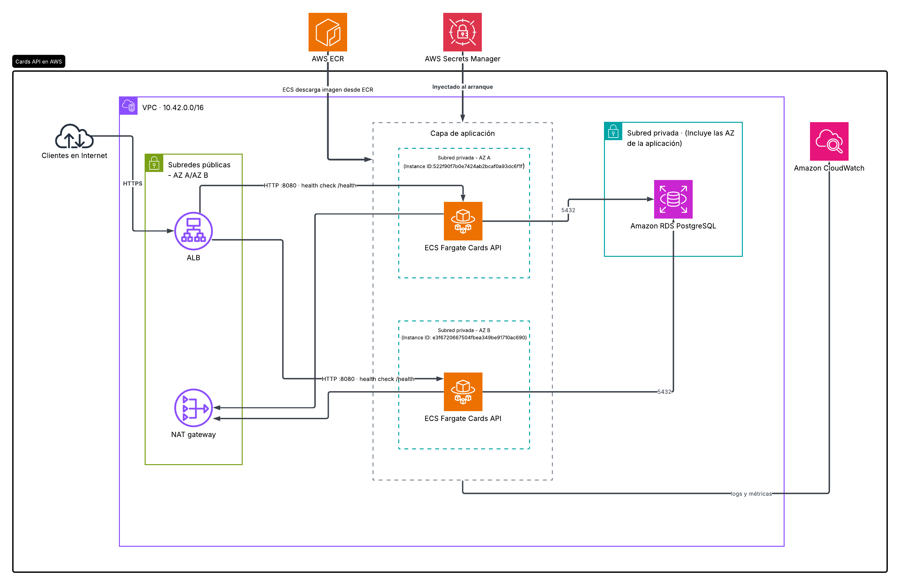
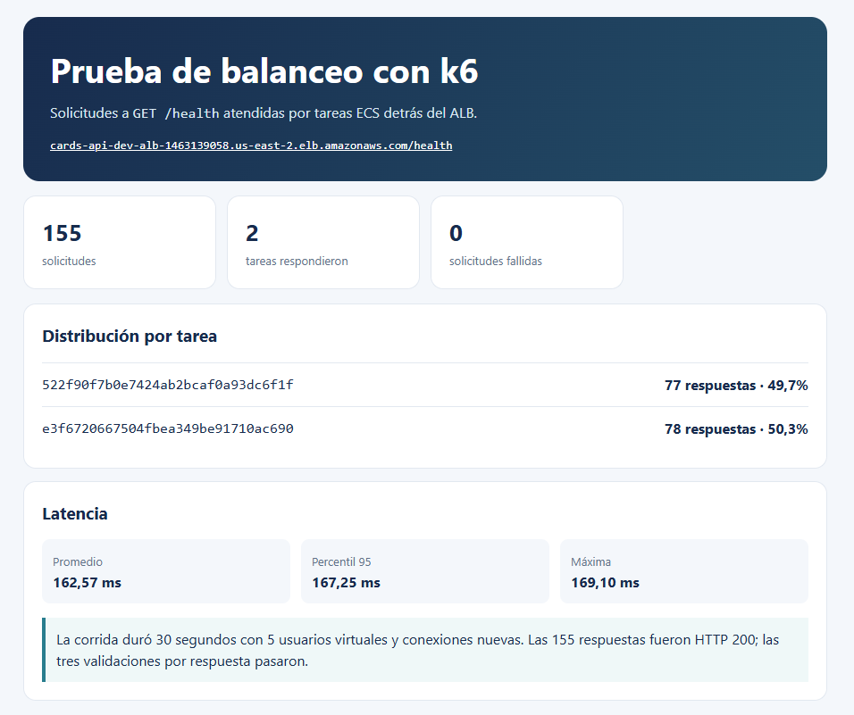

# Cards API

Cards API es un servicio REST en Go para crear y consultar tarjetas de prueba. Guarda los datos en PostgreSQL y se puede ejecutar localmente con Docker Compose o desplegar en AWS con Terraform.

El proyecto se hizo para una prueba técnica. Los PAN son sintéticos: Luhn comprueba el número, pero no si una tarjeta fue emitida o se puede usar para pagar.

## Qué puede hacer la API

- `POST /cards`: crea una tarjeta y requiere `Idempotency-Key`.
- `GET /cards/{id}`: consulta una tarjeta por ID.
- `GET /cards?limit=&cursor=`: lista tarjetas con paginación por cursor.
- `GET /cards:search?last4=`: devuelve todas las tarjetas que coinciden con los últimos cuatro dígitos.
- Validación de PAN con Luhn y expiración mensual.
- Almacenamiento del HMAC-SHA-256 del PAN y de sus últimos cuatro dígitos; no se persiste el PAN en texto claro.
- Pruebas para las reglas de `cardnumber` y el repositorio PostgreSQL.

## Estructura

```text
cmd/api/                      Inicio del servidor
internal/handler/             Endpoints HTTP
internal/service/             Reglas de negocio
internal/repository/postgres/ Consultas a PostgreSQL
internal/cardnumber/          Luhn, expiración y enmascaramiento
internal/database/            Conexión y esquema SQL
k6/                           Prueba de carga de GET /health
deploy/                       Infraestructura AWS con Terraform
```



## Requisitos

- Docker y Docker Compose para el modo local recomendado.
- Go 1.27.1 para ejecutar o probar el servicio directamente en el host.

## Configuración local

El proyecto lee la configuración desde `.env`. Crea ese archivo en la raíz; no subas credenciales ni secretos reales al repositorio.

```dotenv
DB_HOST=localhost
DB_PORT=5432
DB_NAME=card_API_DB
DB_USER=admin
DB_PASSWORD=cambia-esta-clave
DB_SSLMODE=disable
PAN_HASH_SALT=reemplaza-por-un-secreto-aleatorio
HTTP_ADDR=:8080
```

## Ejecutar con Docker Compose

Desde la raíz del proyecto:

```powershell
docker compose up --build -d
```

Compose crea PostgreSQL y la API, pero **no aplica `schema.sql` automáticamente**. Para inicializar una base nueva, copia y ejecuta el esquema dentro del contenedor. Los valores de usuario y base deben coincidir con `DB_USER` y `DB_NAME` de tu `.env`:

```powershell
docker cp .\internal\database\schema.sql postgres_db:/tmp/schema.sql
docker compose exec postgres psql -U admin -d card_API_DB -f /tmp/schema.sql
```

Ejecuta el esquema una vez por base. El volumen `postgres_data` conserva los datos entre reinicios; `docker compose down` no lo elimina. Evita `docker compose down -v` si quieres conservarlos.

Ver logs:

```powershell
docker compose logs -f api
docker compose logs -f postgres
```

La API queda disponible en `http://localhost:8080`.

## Endpoints

### `GET /health`

```bash
curl http://localhost:8080/health
```

Devuelve `200 OK` con `status: "ok"` e `instance_id`. En ECS, ese identificador corresponde a la tarea de Fargate. Fuera de ECS, queda vacío.

Los ejemplos usan `curl`. En PowerShell puedes ejecutar `curl.exe` para evitar el alias de `curl` de algunas versiones.

### Crear una tarjeta

Si se omite `pan`, la API genera un PAN sintético de 16 dígitos que pasa Luhn y calcula una expiración a cinco años de la emisión. Para proporcionar un PAN manual, envía también `expiration_month` en formato `MM` y `expiration_year` en formato `YYYY`; el PAN debe pasar Luhn y la fecha debe ser válida y no estar vencida.

```bash
curl -X POST http://localhost:8080/cards \
  -H 'Content-Type: application/json' \
  -H 'Idempotency-Key: create-card-001' \
  -d '{"holder_name":"Juan Perez"}'
```

También se puede proporcionar un número de prueba válido para Luhn:

```bash
curl -X POST http://localhost:8080/cards \
  -H 'Content-Type: application/json' \
  -H 'Idempotency-Key: create-card-002' \
  -d '{"holder_name":"Filomeno Garcia","pan":"4242424242424242","expiration_month":"12","expiration_year":"2099","is_manual":true}'
```

Respuesta `201 Created`:

```json
{
  "id": "<card-id>",
  "holder_name": "Juan Perez",
  "masked_pan": "************4242",
  "status": "active",
  "expiration_date": "2031-10"
}
```

Para PAN generados, la expiración se calcula a cinco años de la emisión; para PAN manuales, se guarda la fecha enviada. Si se repite la misma solicitud con la misma clave, la API devuelve el resultado guardado en vez de crear otra tarjeta. Si se usa una clave vigente con datos distintos —incluida otra expiración—, responde `409 Conflict`. La clave se conserva por 24 horas.

Al consultar o listar tarjetas, el servicio marca como `expired` las que ya vencieron.

### Consultar por ID

```bash
curl http://localhost:8080/cards/<card-id>
```

Devuelve `200 OK` o `404 Not Found`. Si detecta que una tarjeta activa ya expiró, actualiza su estado a `expired` y la devuelve con ese estado.

### Listar con cursor

```bash
curl 'http://localhost:8080/cards?limit=20'
```

Si hay otra página, pasa `page_info.end_cursor` en la siguiente consulta:

```bash
curl 'http://localhost:8080/cards?limit=20&cursor=<end-cursor>'
```

`limit` es opcional: por defecto es 20 y el máximo es 100. La respuesta tiene esta forma:

```json
{
  "data": [],
  "page_info": {
    "has_next_page": false,
    "end_cursor": null
  }
}
```

El orden es descendente por `issued_at` y `id`. El cursor es opaco para el cliente; debe enviarse de vuelta sin interpretarlo.

### Buscar por últimos cuatro dígitos

```bash
curl 'http://localhost:8080/cards:search?last4=4242'
```

`last4` debe contener exactamente cuatro dígitos ASCII. Si hay coincidencias, responde con un objeto que contiene el arreglo `cards`. Si no encuentra ninguna, responde `404 Not Found`. Esta busqueda no tiene paginacion.

Ejemplo de respuesta con coincidencias:

```json
{
  "cards": [
    {
      "id": "<card-id>",
      "holder_name": "Juan Perez",
      "masked_pan": "************4242",
      "status": "active",
      "expiration_date": "2031-10"
    }
  ]
}
```

Al listar o buscar, la API también actualiza a `expired` las tarjetas vencidas que aún estén activas.

### Errores

Los errores usan un objeto `error` con `code` y `message`. La API responde `400 Bad Request` ante valores inválidos, `404 Not Found` si no encuentra el ID o coincidencias para `last4` y `409 Conflict` si una clave de idempotencia se reutiliza con otros datos. Los errores inesperados devuelven `500 Internal Server Error`.

## PAN y alcance de seguridad

La API usa PAN sintéticos. Luhn verifica una condición matemática del número; no comprueba que el PAN haya sido emitido ni que sea utilizable. No se debe enviar información de una tarjeta real a esta aplicación.

La API guarda un HMAC-SHA-256 del PAN y sus últimos cuatro dígitos; las respuestas solo muestran el valor enmascarado.

Las consultas GET pueden cambiar en la base el estado de una tarjeta vencida. Es una decisión de alcance de esta prueba; en otro diseño, esa actualización podría ejecutarse por separado.

## Logs y métricas

Cada solicitud genera una línea JSON en la salida estándar con la ruta, el estado HTTP y la duración. No se registran encabezados ni cuerpos. En AWS, ECS envía esas líneas a CloudWatch Logs, donde Terraform crea filtros para contar solicitudes, errores 5xx y duración.

## Infraestructura AWS con Terraform

El directorio `deploy/` contiene la infraestructura de la prueba: VPC en dos zonas, ALB público con HTTPS, dos tareas ECS/Fargate en subredes privadas, RDS PostgreSQL, Secrets Manager, ECR y CloudWatch. Terraform crea estos recursos; no hace falta configurarlos uno por uno en la consola.

El certificado autofirmado permite habilitar TLS en el ALB, pero los clientes no lo reconocen como confiable.

Desde Git Bash, en la raíz del repositorio, con GNU Make, Terraform, Docker y AWS CLI instalados y credenciales AWS configuradas, ejecuta el bootstrap una sola vez. Si `deploy/dev.tfvars` no existe, el target lo copia desde el ejemplo:

```bash
make bootstrap
```

El bootstrap crea la infraestructura base y ECR; todavía no crea el servicio ECS porque aún no existe una imagen. La base de datos debe tener el esquema cargado antes de usar los endpoints. Para construir y publicar la imagen y crear o actualizar el servicio ECS, ejecuta:

```bash
make deploy
```

`make deploy` publica la imagen con el tag `latest`, actualiza el servicio ECS para que la descargue y espera a que las tareas queden estables. No edita `dev.tfvars`. Puedes cambiar el tag o la región con `make deploy IMAGE_TAG=mi-tag AWS_REGION=us-east-2`. Para consultar la API:

```bash
make health
```

Esto deja dos tareas de la API detrás del ALB. El certificado HTTPS es autofirmado, así que `curl` necesita `-k` y el navegador mostrará una advertencia. No autentica un dominio público. Si usas otra región, indícala al ejecutar `make deploy AWS_REGION=...`.

La base queda en subredes privadas. ECS recibe `DB_PASSWORD` y `PAN_HASH_SALT` desde Secrets Manager como variables de entorno. La aplicación las lee desde Task Execution Role.

Al terminar, elimina las imágenes del repositorio ECR y ejecuta `make destroy` para destruir la infraestructura. Esto también elimina la base y sus datos.

### Comprobar el balanceo con k6

El script `k6/health.js` consulta `GET /health` durante 30 segundos, valida la respuesta y registra la cantidad de respuestas por `instance_id`. `noConnectionReuse` abre conexiones nuevas para facilitar que el ALB distribuya las solicitudes entre las tareas; la distribución no necesariamente alterna en cada solicitud.

Desde Git Bash, en la raíz del repositorio y con k6 instalado, ejecuta:

```bash
mkdir -p k6/results
k6 run --insecure-skip-tls-verify --out json=k6/results/health.json k6/health.js
```

El flag `--insecure-skip-tls-verify` permite usar el certificado autofirmado de esta prueba. El resumen muestra cuántas respuestas atendió cada `instance_id`; el JSON detallado queda en `k6/results/`. (Carpeta fuera de Git)

Esta corrida produjo 155 respuestas correctas, atendidas por ambas tareas. La gráfica está abajo.



## Pruebas

Ejecuta la suite con:

```bash
go test ./...
```

## Referencias

Las siguientes fuentes sirvieron como material de consulta para decisiones de diseño. No reemplazan las especificaciones técnicas u obligaciones aplicables al entorno donde se despliegue el servicio.

- [Stripe: Designing robust and predictable APIs with idempotency](https://stripe.com/blog/idempotency) — contexto sobre reintentos de red y el uso de claves para evitar efectos duplicados.
- [Visa Core Rules and Visa Product and Service Rules](https://rs.visa.com/dam/VCOM/download/about-visa/visa-rules-public.pdf) — referencia de contexto sobre reglas de productos y cuentas Visa; no se usa como especificación del algoritmo Luhn de este prototipo.
- [PCI SSC FAQ 1089: hashing PAN](https://www.pcisecuritystandards.org/faqs/1089/) — orientación sobre hashing de PAN y alcance PCI DSS; el uso de HMAC aquí no implica que el sistema esté fuera de alcance ni certificado.
- [DEV: Build a Credit Card validator using Go](https://dev.to/claudbytes/build-a-credit-card-validator-using-go-5d2b) — referencia didáctica para el cálculo Luhn en Go.
- [OneUptime: cursor-based pagination in Go REST APIs](https://oneuptime.com/blog/post/2026-01-25-cursor-based-pagination-go-rest-apis/view) — cursor compuesto, orden estable, consulta por rango y detección de página siguiente.
- [OneUptime: idempotency keys for safe API retries in Go](https://oneuptime.com/blog/post/2026-01-25-idempotency-keys-safe-api-retries-go/view) — claves de idempotencia y respuestas reproducibles ante reintentos.
